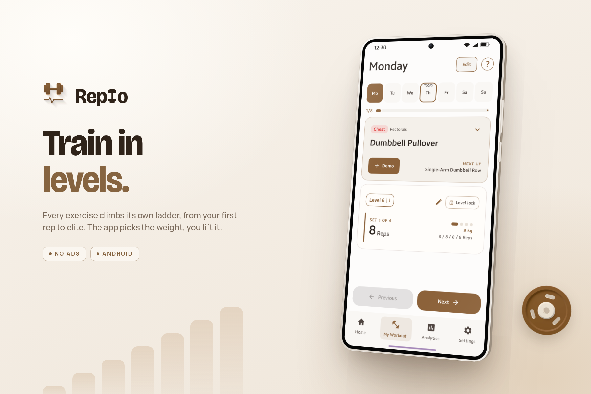
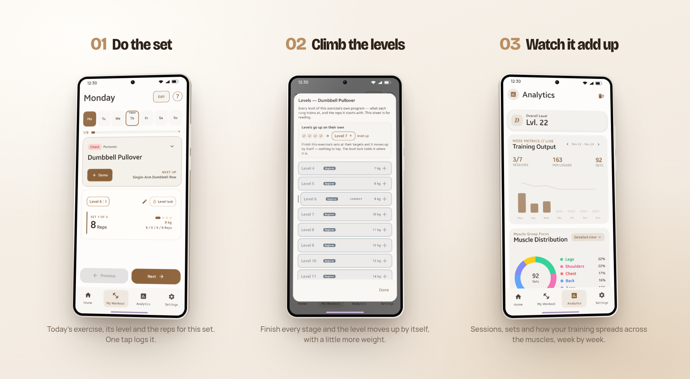
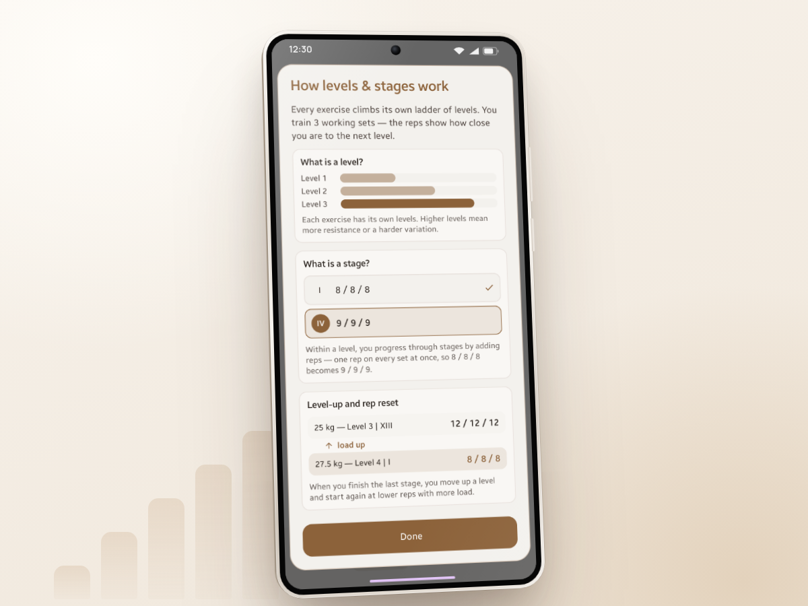
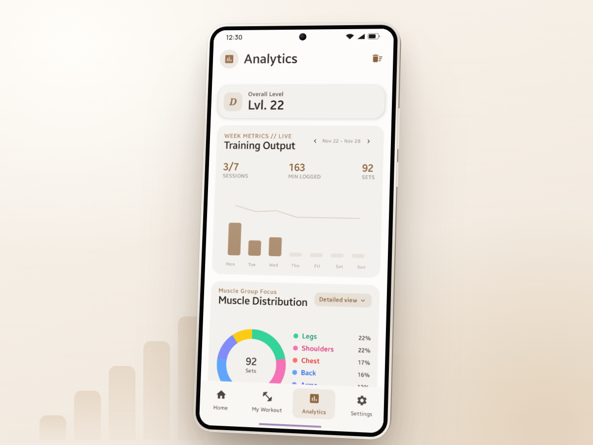
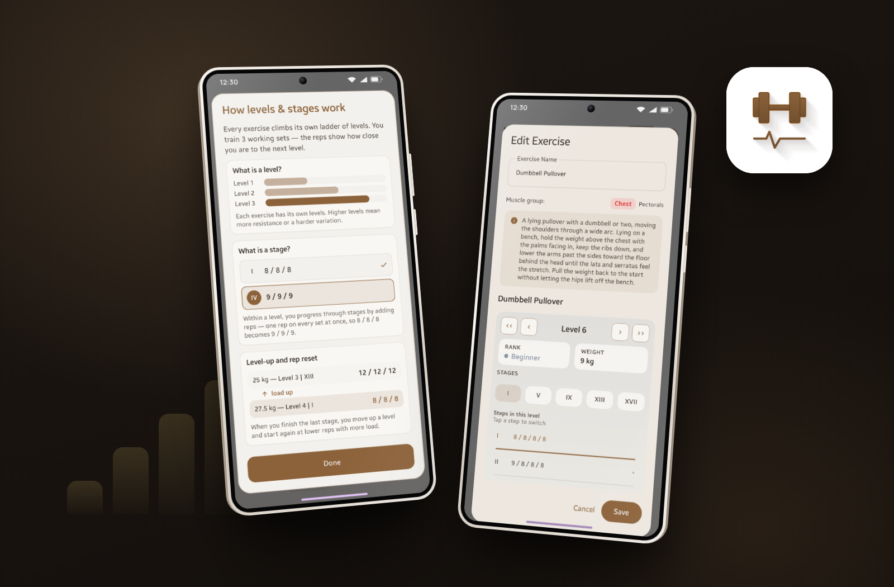
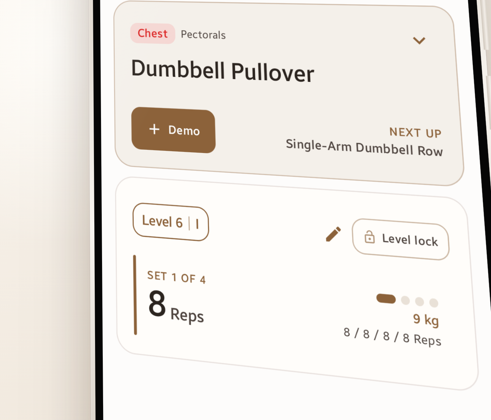

<div align="center">


# RepIo

**A workout tracker that trains in levels.** Every exercise climbs its own ladder, from your first rep to elite. RepIo picks the weight and the reps, and moves you up when you've earned it.

<sub>A <a href="https://github.com/grafizum">Grafizum</a> studio product</sub>

[](https://play.google.com/store/apps/details?id=com.grafizum.repio)
[](#-build-from-source)
[](version.properties)
[](#-features)
[](#-features)
[](#-licence)

[Get it](#-get-it) · [How it works](#-how-it-works) · [Features](#-features) · [Screenshots](#-screenshots) · [The level system](#-the-level-system) · [Build from source](#-build-from-source) · [Licence](#-licence)



</div>

---

No ads, no distractions, just your training. Tell RepIo how many days a week you train and it builds the week: the split, the exercises and a starting weight for each one. From then on, every set you log moves you along that exercise's ladder.

## 🧭 How it works



1. **Do the set.** My Workout shows today's exercise, its level, and the reps and weight for this set. Log it and move on to the next.
2. **Climb the levels.** Finish every stage of a level and it moves up by itself, with a little more weight. The level lock holds an exercise where it is when you want it to stay.
3. **Watch it add up.** Analytics counts the week's sessions, sets and minutes, shows how the work spreads across your muscles, and rolls everything into one overall level.

## ✨ Features

- **A level for every exercise.** Loads come from published strength standards and run from Beginner through Novice, Intermediate and Advanced to Elite, in steps your gym can actually load.
- **Stages inside each level.** Reps climb one at a time (8 / 8 / 8, then 9 / 9 / 9) until the level is done, then the weight goes up and the reps start again.
- **Progressions when you're ready.** Master an exercise and RepIo offers a harder variation of the movement. Say "Not now" and you simply keep climbing.
- **Quick setup.** Answer how many days you train, your sex and your bodyweight, and the week is built. Advanced setup adds your equipment, goal, exact days, split and session length.
- **Over 600 exercises.** Filter by the equipment you own and by muscle group, and swap any exercise for another.
- **Your own routines.** Change the level and stage of any exercise, or switch to custom mode and set your own sets and reps.
- **Kilograms or pounds.** Weights are stored once and shown in your unit, with pound steps a US gym stocks.
- **Eight colour themes**, light and dark. The app icon follows the theme you pick.
- **English, German and Italian.**
- **No ads.**

## 📲 Get it

RepIo is on Google Play:

**[play.google.com/store/apps/details?id=com.grafizum.repio](https://play.google.com/store/apps/details?id=com.grafizum.repio)**

It needs Android 7.0 or newer. Every version is also on the [releases page](https://github.com/MatrixZockt/RepIo-WorkoutTracker/releases), and you can always build it yourself (see below).

## 🖼 Screenshots

| How levels and stages work | The week, in numbers |
| --- | --- |
|  |  |

<div align="center">

</div>

## 🪜 The level system

A level is a weight and a rep target. Each level has stages, written in Roman numerals, that add reps one at a time. When you finish the last stage, the level goes up, the weight rises by that exercise's own step, and the reps reset.

<div align="center">

</div>

- **Where the numbers come from.** Each weighted ladder tops out at a load taken from published strength standards. Bodyweight exercises climb in reps instead, and holds in seconds.
- **The max is a marker, not a wall.** The ladder marks the realistic top, and you can keep climbing past it, up to elite.
- **Levels can come down.** Two sessions in a row with a missed set, or a few weeks away, take an exercise back a level, so a comeback starts at a weight you can lift.

## 🛠 Build from source

Requirements: Android Studio, JDK 17 and Android SDK 36.

```bash
./gradlew :composeApp:assembleDebug
./gradlew :composeApp:testDebugUnitTest
```

The debug build installs next to the store version (`com.grafizum.repio.debug`). Release signing reads its keys from a local `.env` that is not in the repository. Building a release also advances the version code in `version.properties`, so only do that when you mean to ship.

**Stack:** Kotlin, Jetpack Compose, Material 3, Room, Firebase and Google Play in-app updates. Minimum Android 7.0 (API 24), target API 36.

## 📄 Licence

RepIo is licensed under the [GNU General Public License v3.0](LICENSE) (GPLv3).
You are free to run, study, share and modify it. If you distribute a modified
version, it must carry the same licence and its source code, so nobody can take
it and make it closed.

## 🙏 Acknowledgments

Thanks to [Grafizum](https://github.com/grafizum) for helping me manage this project and stay organized while building it.

---

<div align="center"><sub>Made by <a href="https://github.com/grafizum">Grafizum</a></sub></div>
